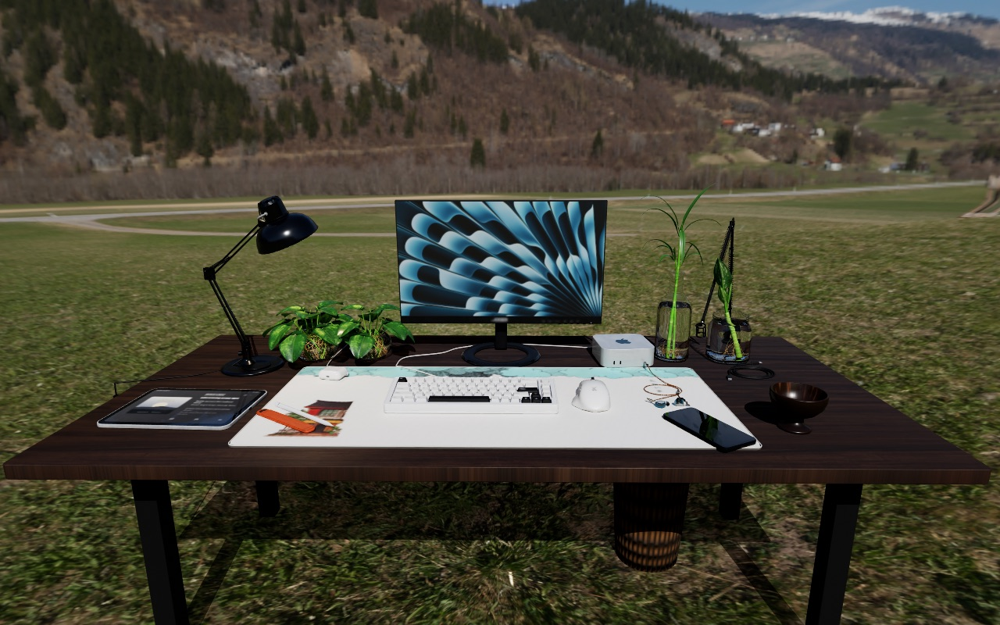
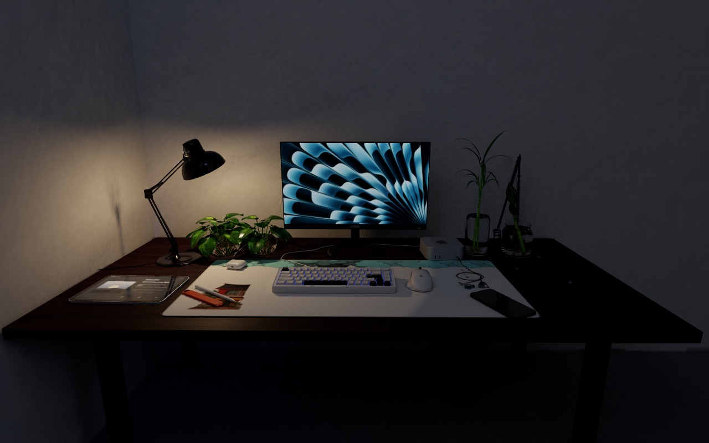
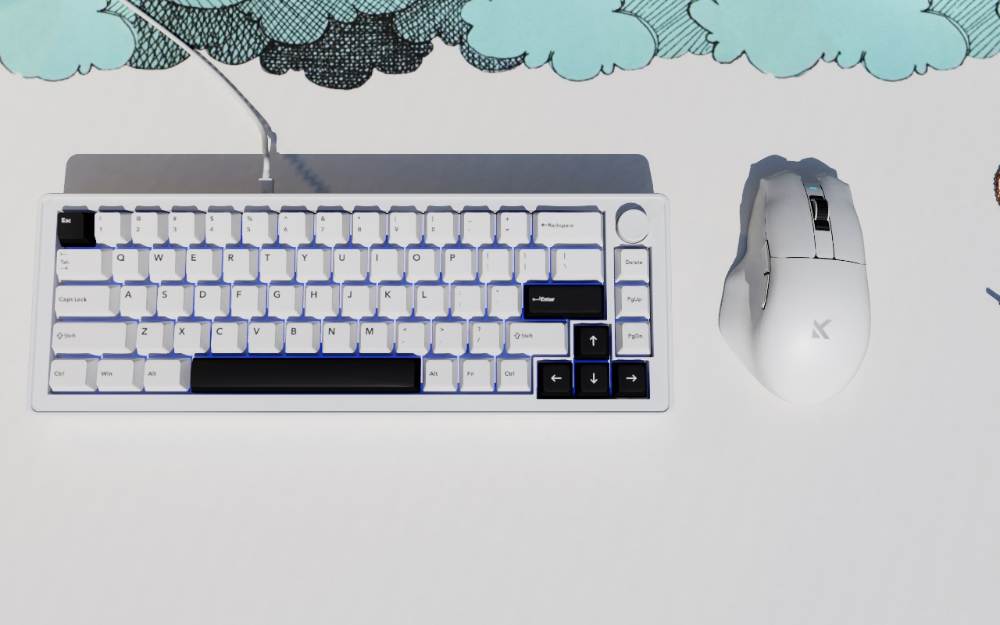
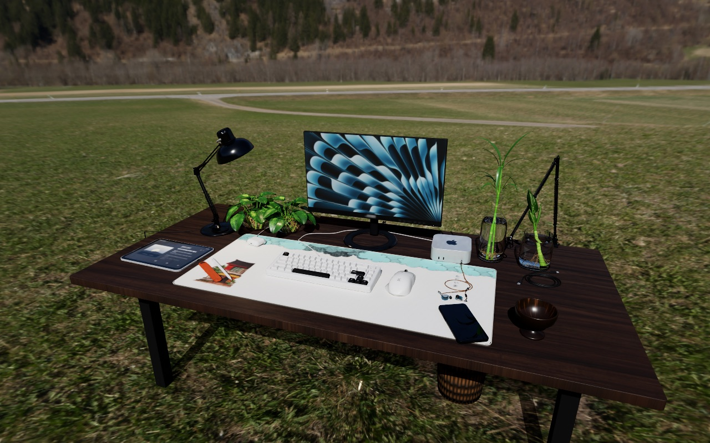
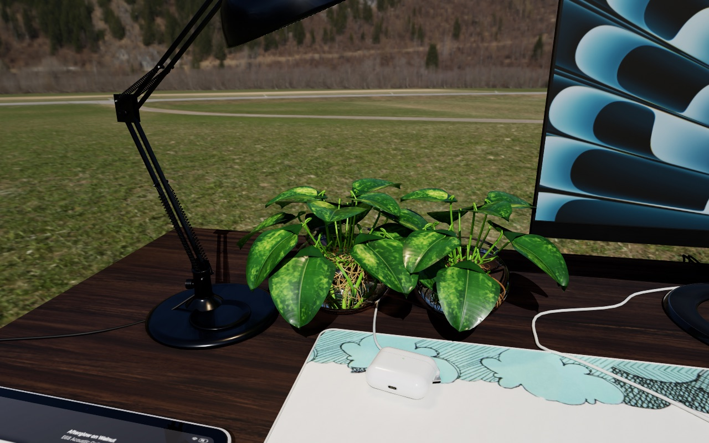

# E68 Studio

A native macOS companion app for the **Furycube E-68 PRO** keyboard and the **MCHOSE G7** mouse. It remaps keys and the knob, edits macros, drives the backlight from music, screen or wallpaper colours, remaps mouse buttons and DPI, and shows your real desk as a live, hardware ray-traced 3D scene.

Swift 5.9 · SwiftUI · SceneKit + Metal ray tracing · CoreAudio · IOKit HID · CoreBluetooth · no third-party dependencies.



| | |
|---|---|
|  |  |
|  |  |

All images are rendered headlessly by the app itself (`--render-closeups`).

> **Build your own:** [`Framework/`](Framework/README.md) is a step-by-step playbook for building an app like this one for *your* keyboard and mouse with any AI coding harness (Claude Code, Codex, Cursor, Gemini CLI, Aider…).

## Quick start

```bash
git clone <this repo> && cd <repo>
swift build
.build/debug/E68Studio --selftest      # offline checks + live checks if the hardware is connected
./Scripts/build-app.sh                 # writes dist/E68 Studio.app
open "dist/E68 Studio.app"
```

Requires **macOS 26** and the Xcode Command Line Tools. An Apple Silicon Mac with Metal ray tracing is recommended for the 3D desk; other Macs fall back to plain SceneKit rendering.

### Installing a shared build

Builds made without an Apple Developer ID are not notarised, so Gatekeeper blocks them on other Macs. After unzipping, either right-click the app → **Open** → **Open**, or run:

```bash
xattr -dr com.apple.quarantine "E68 Studio.app"
```

To produce a notarised build that opens normally, see [Signing and notarisation](#signing-and-notarisation).

## Supported hardware

- **Furycube E-68 PRO**
  - **USB (`320F:5055`) and 2.4 GHz dongle (`320F:5088`):** full VIA v9 lighting, macros and keymap over raw HID (`FF60:61`), preferring USB over the dongle.
  - **Bluetooth (`245A:8276`):** connection detection, battery level (`180F`/`2A19`) and Key Test.
- **MCHOSE G7** (USB `A8A4`, 2.4 GHz `A8A5`, Bluetooth `2717:32B0`): per-device pointer speed and acceleration, multi-stage DPI with an on-screen HUD, sniper DPI, button and gesture remapping, scroll speed and direction, double-click debounce, and a polling-rate tester. On-board mouse settings are not written; the vendor protocol is undocumented.

## Features

- **3D keymap and knob remapper.** Click a keycap or the knob on the 3D keyboard to bind VIA keycodes, media keys, layer switches or macros on all four layers.
- **Live 3D desk.** A Metal hardware ray tracer draws the desk in eight photographed worlds, day and night, with a working desk lamp, reactive typing ripples, a keystroke heatmap and camera bookmarks.
- **Music, screen and wallpaper lighting.** Captures system audio (CoreAudio process tap), splits it into 16 bands with beat detection, samples screen or wallpaper colours, and streams lighting at about 60 Hz.
- **Profiles, macros, snippets, Key Test and backup.** Per-app profiles, a 16-slot macro editor and recorder, global shortcuts and text snippets, a Key Test HUD with WPM, low-battery notifications, and JSON backup and restore.
- **Menu bar companion.** Backlight, brightness, Sound Wave, DPI stage and profile switching from the menu bar, with an optional Dock-less background mode.

## Permissions

The app is not sandboxed (raw HID access needs that) and runs with the Hardened Runtime ([`Scripts/E68Studio.entitlements`](Scripts/E68Studio.entitlements)).

| Permission | Used for | Without it |
|---|---|---|
| Accessibility | Mouse remapping, scroll scaling, debounce, global shortcuts, snippets, Key Test | Those features stay off |
| Bluetooth | Battery level of Bluetooth devices | USB and 2.4 GHz still work |
| Screen Recording | Screen Glow colour sampling | Screen Glow is unavailable |
| System Audio Recording | Sound Wave music lighting | Sound Wave is unavailable |

Nothing leaves your Mac: the app has no network code and no analytics.

**Background behaviour.** With *Show in menu bar* and *Keep running when window closes* on (the default), closing the window keeps remapping, shortcuts, snippets, profiles and battery monitoring running. Quitting stops every tap and monitor and flushes pending keyboard changes. Custom DPI and acceleration stay in macOS until the mouse reconnects or you reset them in **Mouse › More**.

## Command-line modes

| Command | What it does |
|---|---|
| `E68Studio --selftest` | Codec, layout, audio, scene and ray-tracer checks; with the keyboard on USB it also writes and restores keys, macros and lighting |
| `E68Studio --backup <file>` | Saves the keyboard configuration to JSON |
| `E68Studio --render-closeups <dir>` | Renders close-up views; add `-e68.closeupScenario room -e68.closeupMood midnight -e68.closeupOnly home` to pick one |
| `E68Studio --render-scenarios <dir>` | Renders every world |
| `E68Studio --render-switch <dir>` / `--render-motion <dir>` | Frames across a world switch or a camera orbit |

## Project layout

```text
Package.swift
Sources/E68Studio/
  App/          entry point and CLI modes (SelfTest, SceneRender, BackupCLI)
  HID/          Keyboard (raw HID, VIA v9, event taps, Bluetooth), Mouse (remapper), Shared (battery)
  Audio/        process tap, FFT, cover-art colours, music light engine
  Samplers/     screen and wallpaper colour samplers
  Model/        settings, colour math, profiles, keyboard and mouse models
  Store/        KeyboardStore, MouseStore, ProfileStore, LiveMirror, TextExpander
  Scene/        SceneView, World, Devices, Environment, RayTracer (Metal live renderer + path tracer)
  Views/        Chrome, Components, Sections/Keyboard, Sections/Mouse
Resources/      HDR panoramas, desk wood, plant textures, VIA definitions, desk mat
Scripts/        build-app.sh, notarize-app.sh, icon and mat generators, entitlements
Docs/Renders/   README images
Framework/      playbook for building your own device studio with an AI harness
AGENTS.md       rules for AI agents working in this repo
```

Local-only and git-ignored: `dist/` (built app), `Backups/` (device backups), `Docs/Reference/` (raw desk photos and old comparison renders).

## Signing and notarisation

`Scripts/build-app.sh` signs with `CODESIGN_IDENTITY` if set, otherwise a local identity named `E68StudioLocal` if present, otherwise ad hoc. For a build anyone can open, you need an Apple Developer ID:

```bash
xcrun notarytool store-credentials "e68-notary" \
  --apple-id "<you@example.com>" --team-id "<TEAMID>" --password "<app-specific-password>"

BUNDLE_ID="com.example.e68studio" APP_VERSION="1.0.0" \
CODESIGN_IDENTITY="Developer ID Application: Your Name (TEAMID)" \
./Scripts/build-app.sh

./Scripts/notarize-app.sh --bundle-id "com.example.e68studio" --keychain-profile "e68-notary" --format dmg
```

The result lands in `dist/`. `./Scripts/notarize-app.sh --help` lists every option, including App Store Connect API keys.

## Credits, trademarks and licence

Code is released under the [MIT licence](LICENSE). HDR environments and the desk wood are CC0 from Poly Haven; every bundled asset is listed in [Resources/ASSET_CREDITS.md](Resources/ASSET_CREDITS.md).

Furycube, MCHOSE, ASUS, Apple, Mac mini, iPad and AirPods are trademarks of their owners. This project is not affiliated with or endorsed by any of them; device models and logos are drawn only to depict the author's own desk. The desk mat image (`Resources/ukiru-mat.jpg`) is derived from a photo of a commercial mat; replace it with your own artwork before distributing builds widely.
